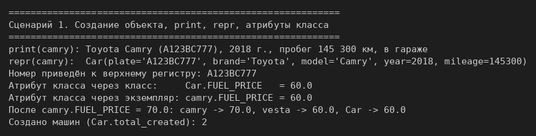
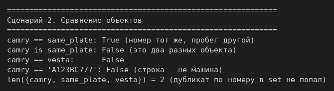
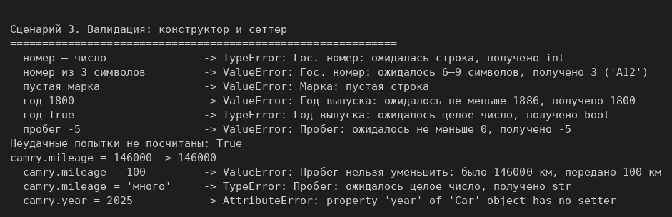
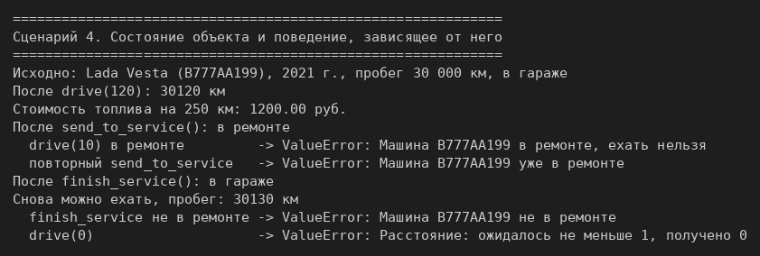

# ЛР-1 — Класс и инкапсуляция

## 1. Цель работы
Освоить объявление класса, инкапсуляцию (закрытые поля `_имя`), свойства `@property`
с сеттером и валидацией, магические методы `__str__`, `__repr__`, `__eq__`, разницу
между атрибутами класса и экземпляра, а также логическое состояние объекта.

## 2. Ход рассуждений: как появился класс `Car`

Предметная область — **Транспорт** (вариант 5), сущность — `Car`.

### Вопрос 1. Что является сущностью?
Конкретная машина автопарка со своим гос. номером. Не «модель Toyota Camry» как товар
(у модели нет пробега и статуса) и не сам автопарк — он появится в ЛР-2 отдельным
классом-контейнером.

### Вопрос 2. Какие у неё атрибуты?
| Атрибут | Тип | Меняется? | Что это |
|---|---|---|---|
| `_plate` | str | нет | гос. номер — идентификатор |
| `_brand`, `_model` | str | нет | марка и модель |
| `_year` | int | нет | год выпуска |
| `_mileage` | int | только растёт (сеттер) | пробег, км |
| `_status` | str | только методами | «в гараже» или «в ремонте» |

Атрибуты класса — общие для всех машин: `MIN_YEAR`, `MAX_YEAR`, `FUEL_CONSUMPTION`
(л на 100 км), `FUEL_PRICE` (руб. за литр), константы статусов и счётчик `total_created`.

Стоимость поездки не хранится, а считается методом `trip_cost(distance)`: она зависит
от расстояния.

### Вопрос 3. Какие инварианты?
- номер — строка из 6–9 символов (приводится к верхнему регистру без пробелов);
- марка и модель — непустые строки;
- `MIN_YEAR ≤ год ≤ MAX_YEAR`, год — `int`, но не `bool`;
- пробег — целое число ≥ 0, и он никогда не уменьшается;
- расстояние поездки — целое число ≥ 1;
- машине в ремонте ездить нельзя.

Все проверки — функции `_validate_*` в `validate.py`. Конструктор и сеттер пробега
вызывают одну и ту же `_validate_mileage`, поэтому правило записано один раз.

### Вопрос 4. Что значит «равенство»?
Две машины равны, если совпадает гос. номер: машина после поездки остаётся той же
машиной, хотя пробег вырос. Раз определён `__eq__`, определён и `__hash__` (тоже по номеру):
без него машину нельзя положить в `set` или сделать ключом словаря.

### Вопрос 5. Есть ли состояние?
Да, два статуса и два перехода:

```
в гараже  --send_to_service()-->  в ремонте  --finish_service()-->  в гараже
```

Методы перехода проверяют, что переход возможен, и меняют только `_status`.
Бизнес-метод `drive()` сначала проверяет статус: в ремонте он бросает `ValueError`.
Сеттера у `status` нет, чтобы статус нельзя было поменять в обход этих проверок.

## 3. Структура
- `validate.py` — проверки: `_validate_text`, `_validate_plate`, `_validate_int` и три обёртки
  над ней (`_validate_year`, `_validate_mileage`, `_validate_distance`);
- `model.py` — класс `Car`;
- `demo.py` — четыре сценария.

## 4. Соответствие заданию
| Требование | Где сделано |
|---|---|
| ≥ 4 закрытых атрибута, конструктор с проверкой | `_plate`, `_brand`, `_model`, `_year`, `_mileage`, `_status`; `__init__` |
| свойства только для чтения | `plate`, `brand`, `model`, `year`, `status` |
| `__str__`, `__eq__`, `__repr__` | конец класса `Car` |
| сеттер с валидацией (тип + логика) | `mileage.setter`: целое, ≥ 0, нельзя уменьшить |
| атрибут класса | `MIN_YEAR`, `FUEL_PRICE`, `total_created` и др. |
| два бизнес-метода | `drive(distance)`, `trip_cost(distance)` |
| валидация в отдельном файле без дублирования | `validate.py` |
| метод смены состояния | `send_to_service()`, `finish_service()` |
| поведение зависит от состояния | в ремонте `drive()` запрещён; переходы проверяют текущий статус |
| сверх задания | `__hash__`, нормализация номера, атрибут экземпляра против атрибута класса |

## 5. Демонстрация работы
Запуск из папки `src/lab01`: `python demo.py`.

**Сценарий 1.** Создание объектов, `print` и `repr`, атрибут класса через класс и через
экземпляр. Присваивание `camry.FUEL_PRICE = 70.0` создаёт собственный атрибут экземпляра:
у класса и у других машин цена остаётся 60.



**Сценарий 2.** Сравнение: `==` по номеру, `is` по объекту, сравнение со строкой, `set` без дубликата.



**Сценарий 3.** Валидация: шесть некорректных конструкторов через `try/except` (счётчик при
этом не растёт), сеттер пробега и свойство без сеттера.



**Сценарий 4.** Состояние: поездка и её стоимость, ремонт запрещает `drive()`, неверные
переходы дают ошибку, после ремонта снова можно ехать.



## 6. Вывод
Изучены классы и объекты, инкапсуляция через закрытые поля и свойства, валидация входных
данных в отдельных функциях, магические методы, атрибуты класса и экземпляра, логическое
состояние объекта и поведение, которое от него зависит.
