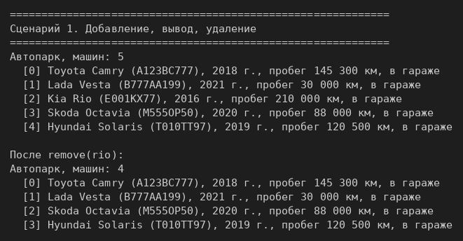
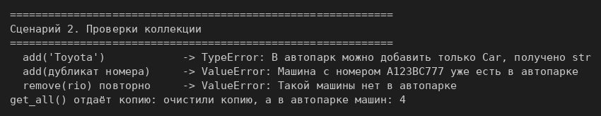
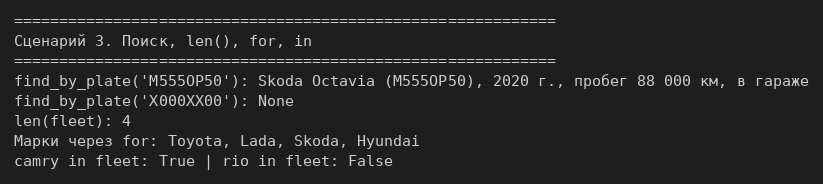
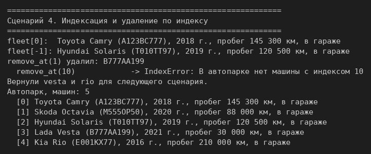
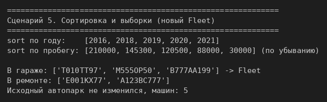

# ЛР-2 — Коллекция объектов

## 1. Цель работы
Понять разницу между моделью сущности (`Car`) и контейнером объектов (`Fleet`),
реализовать собственный контейнерный класс: добавление, удаление, поиск, итерацию,
индексацию, сортировку и выборки.

## 2. Описание коллекции `Fleet` (автопарк)
`Car` взят из ЛР-1 без изменений. `Fleet` хранит машины в списке `self._items` и
**не наследуется от `list`** (композиция): снаружи доступны только наши методы с
проверками, а `append` или `insert` в обход проверок недоступны.

| Задание | Что реализовано |
|---|---|
| на 3 | `add()` — только `Car` (`TypeError`) и без дубликатов номера (`ValueError`); `remove()`; `get_all()` |
| на 4 | `find_by_plate()`; `__len__`; `__iter__`; запрет дубликатов |
| на 5 | `__getitem__`; `remove_at(index)`; универсальная `sort(key, reverse)`; `get_available()` и `get_in_service()` возвращают **новый** `Fleet` |

Ключевые решения:
- дубликат ищется выражением `car in self._items`, а оно сравнивает через `Car.__eq__`, то есть по номеру;
- `get_all()` отдаёт копию списка: изменив копию, автопарк не испортишь;
- `sort()` — действие, оно меняет порядок в этом автопарке; выборки — запросы, они
  возвращают новый `Fleet`, а исходный не меняется;
- конструктор `Fleet(cars)` добавляет машины через `add()`, поэтому выборка пишется одной
  строкой и проходит те же проверки;
- отдельный `__contains__` не нужен: `car in fleet` работает через `__iter__`.

## 3. Демонстрация работы
Запуск из папки `src/lab02`: `python demo.py`.

**Сценарий 1.** Добавление пяти машин, вывод, удаление, повторный вывод (задание на 3).

**Сценарий 2.** Проверки: объект не того типа, дубликат номера, удаление отсутствующей
машины; `get_all()` возвращает копию.

**Сценарий 3.** Поиск по номеру (найдено и `None`), `len()`, `for`, `in` (задание на 4).

**Сценарий 4.** Индексация `fleet[0]` и `fleet[-1]`, удаление по индексу и ошибка
несуществующего индекса (задание на 5).

**Сценарий 5.** Сортировка по году и по пробегу; выборки возвращают новый `Fleet`,
исходный автопарк не меняется (задание на 5).

## 4. Вывод
Изучены контейнерные классы и композиция, протоколы итерации и индексации (`__len__`,
`__iter__`, `__getitem__`), сортировка по функции-ключу и разница между методом-действием
и методом-запросом, который возвращает новую коллекцию.
