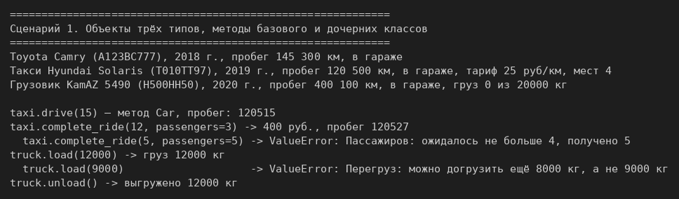
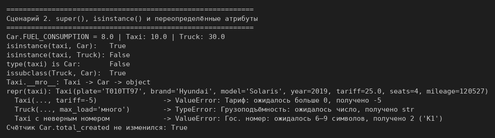
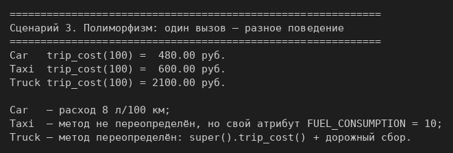
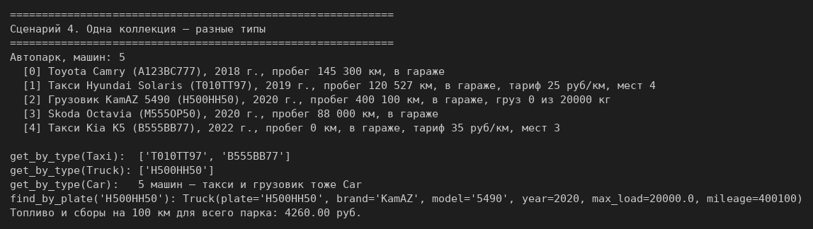

# ЛР-3 — Наследование и иерархия классов

## 1. Цель работы
Освоить наследование и `super()`, переопределение методов и атрибутов класса,
проверку типов через `isinstance()`, полиморфизм без условий и работу коллекции
с объектами разных типов.

## 2. Описание иерархии
```
Car    (base.py)     машина из ЛР-1
 ├── Taxi  (models.py)   + тариф и число мест; complete_ride()
 └── Truck (models.py)   + грузоподъёмность и груз; load(), unload()
```

**Базовый класс `Car`** — класс из ЛР-1. Добавлен только общий метод `display()`
(описание одной строкой), а `__str__` теперь вызывает `self.display()`. Общий интерфейс
иерархии — два метода базового класса: `display()` и `trip_cost(distance)`.

**`Taxi`**
- новые атрибуты: `_tariff` (руб. за км), `_seats` (мест для пассажиров);
- новый метод: `complete_ride(distance, passengers)` — проверяет число пассажиров,
  вызывает унаследованный `drive()` и возвращает цену поездки;
- переопределены: атрибут класса `FUEL_CONSUMPTION = 10`, методы `display()` и `__repr__`.

**`Truck`**
- новые атрибуты: `_max_load` (кг), `_cargo` (груз сейчас, кг);
- новые методы: `load(kg)` (перегруз запрещён), `unload()`;
- переопределены: атрибут `FUEL_CONSUMPTION = 30`, метод `trip_cost()` (топливо через
  `super().trip_cost()` + дорожный сбор), `display()` и `__repr__`.

Чем отличаются: `trip_cost(100)` даёт 480 руб. у `Car`, 600 у `Taxi` (метод тот же, но свой
атрибут класса — `self.FUEL_CONSUMPTION` ищется с класса объекта) и 2100 у `Truck`
(метод переопределён).

Код `Car` не копируется: конструкторы потомков вызывают `super().__init__()`.
Порядок в конструкторе потомка: **проверить свои аргументы → `super().__init__()` →
записать свои атрибуты**. Поэтому при неверном тарифе объект не создаётся и счётчик
`Car.total_created` не растёт.

**Коллекция** (`collection.py`) — `Fleet` из ЛР-2. `add()` проверяет `isinstance(car, Car)`,
поэтому принимает и потомков. Добавлен `get_by_type(car_type)` — новый автопарк из машин
одного типа. `isinstance` учитывает наследование: `get_by_type(Car)` вернёт все машины.

## 3. Соответствие заданию
| Требование | Где сделано |
|---|---|
| базовый класс из ЛР-1, ≥ 2 потомка | `Car` → `Taxi`, `Truck` |
| 2 новых атрибута и ≥ 1 новый метод у каждого | `_tariff`, `_seats`, `complete_ride()`; `_max_load`, `_cargo`, `load()`, `unload()` |
| `super()` в конструкторе, без дублирования | `super().__init__(...)` в обоих потомках |
| переопределение метода | `display()`, `trip_cost()` у `Truck`, `__repr__` |
| `isinstance()` | `Fleet.add()`, `Fleet.get_by_type()`, демо |
| полиморфное поведение | `trip_cost()` и `display()` дают разный результат |
| коллекция хранит разные типы | `Fleet` из ЛР-2 |
| общий интерфейс через базовый класс | `display()` и `trip_cost()` объявлены в `Car` |
| полиморфизм без `if type == ...` | цикл `for car in fleet: car.trip_cost(100)` |
| фильтрация по типу | `get_by_type(Taxi)`, `get_by_type(Truck)` |

## 4. Демонстрация работы
Запуск из папки `src/lab03`: `python demo.py`.

**Сценарий 1.** Объекты трёх типов; унаследованный `drive()` и собственные методы
`complete_ride()`, `load()`, `unload()` с проверками.



**Сценарий 2.** Переопределённые атрибуты класса, `isinstance()`, `type()`, `issubclass()`,
`__mro__`, `repr`; ошибки в конструкторах потомков не увеличивают счётчик.



**Сценарий 3.** Полиморфизм: один вызов `trip_cost(100)` — три разных результата без `if`.



**Сценарий 4.** Одна коллекция с машинами разных типов: вывод, выборка по типу, поиск,
общая стоимость поездки по всему парку.



## 5. Вывод
Изучены наследование и `super()`, переопределение методов и атрибутов класса, порядок
поиска метода по MRO, проверка типов через `isinstance()` и полиморфизм: один вызов —
разное поведение без условий по типу.
