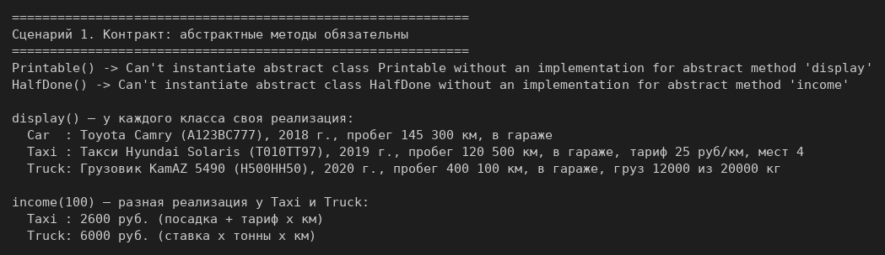
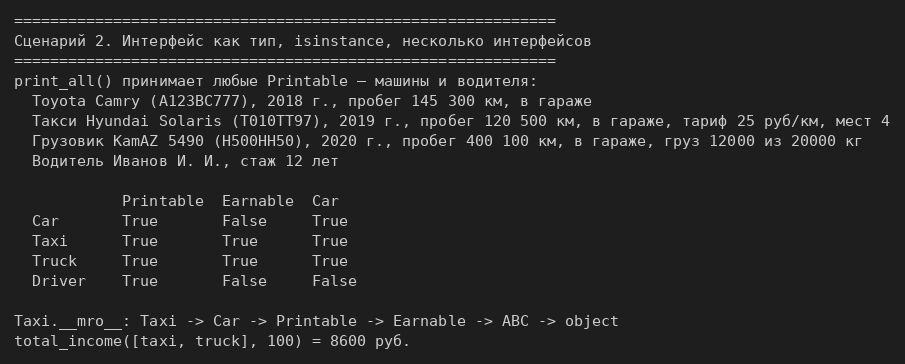
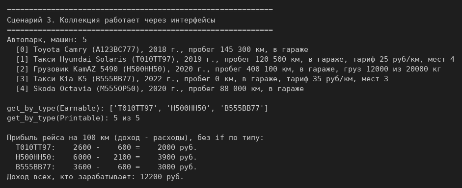

# ЛР-4 — Интерфейсы и абстрактные классы (ABC)

## 1. Цель работы
Ввести контракты поведения через `abc.ABC` и `@abstractmethod`, использовать интерфейс
как тип, реализовать несколько интерфейсов в одном классе и работать с коллекцией
через интерфейсы.

## 2. Описание интерфейсов (`interfaces.py`)
| Интерфейс | Обязательный метод | Смысл |
|---|---|---|
| `Printable` | `display() -> str` | умеет описать себя строкой |
| `Earnable` | `income(distance) -> float` | приносит доход за рейс |

Создать объект интерфейса нельзя. Класс, который наследует интерфейс и не реализует
его абстрактный метод, тоже нельзя создать: Python бросает `TypeError`.

## 3. Реализация в классах (`models.py`)
```
Car(Printable)
 ├── Taxi(Car, Earnable)
 └── Truck(Car, Earnable)
```
- `display()` реализован по-своему в `Car`, `Taxi` и `Truck`.
- `income()`: у `Taxi` — посадка + тариф × км; у `Truck` — ставка × тонны груза × км,
  поэтому пустой грузовик ничего не зарабатывает.
- Обычная `Car` дохода не приносит, поэтому `Earnable` не реализует. `Taxi` и `Truck`
  реализуют два интерфейса сразу: `Printable` через `Car` и `Earnable` напрямую.

`services.py` — универсальные функции, которые знают только интерфейсы (в этом файле
нет импорта машин): `print_all(items: Iterable[Printable])` и
`total_income(items: Iterable[Earnable], distance)`.

**Коллекция** (`collection.py`) — `Fleet` из ЛР-3. Отдельный метод для фильтрации по
интерфейсу не понадобился: `isinstance` работает и с ABC, поэтому `get_by_type(Earnable)`
отбирает всех, кто приносит доход. Вывод автопарка идёт через `display()`.

## 4. Соответствие заданию
| Требование | Где сделано |
|---|---|
| ≥ 2 интерфейса с `@abstractmethod` | `Printable`, `Earnable` |
| ≥ 2 класса реализуют интерфейс, реализации разные | `display()` в трёх классах, `income()` в двух |
| интерфейс как тип, универсальная функция | `print_all(items: Iterable[Printable])`, `total_income(...)` |
| несколько интерфейсов в одном классе | `Taxi`, `Truck` |
| `isinstance(obj, Printable)` | демо, сценарий 2 |
| коллекция фильтрует по интерфейсу | `fleet.get_by_type(Earnable)` |
| полиморфизм через интерфейс без условий | `item.display()`, `car.income(100)` в циклах |
| архитектурное поведение | вывод через `Printable`, подсчёт дохода и прибыли через `Earnable` |
| сверх задания | класс `Driver` (не машина) тоже выполняет `Printable` |

## 5. Демонстрация работы
Запуск из папки `src/lab04`: `python demo.py`.

**Сценарий 1.** Контракт: нельзя создать `Printable()` и класс, не реализовавший `income()`;
у каждого класса своя реализация `display()` и `income()` (задание на 3).



**Сценарий 2.** Интерфейс как тип: `print_all()` принимает машины и водителя;
таблица `isinstance` по интерфейсам; `Taxi.__mro__` с двумя интерфейсами (задание на 4).



**Сценарий 3.** Единый автопарк из машин разных типов: вывод через `Printable`, фильтрация
по `Earnable`, прибыль рейса и общий доход без `if` по типу (задание на 5).



## 6. Вывод
Изучены абстрактные классы и интерфейсы как контракты поведения, множественная реализация
интерфейсов, использование интерфейса как типа и полиморфизм через интерфейс без условий.
