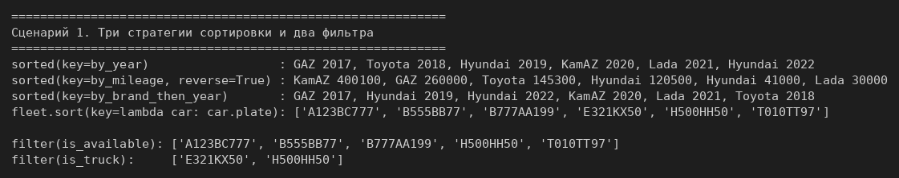
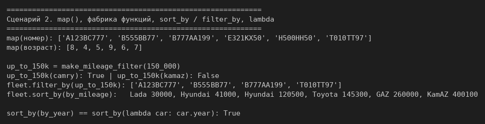
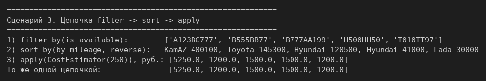
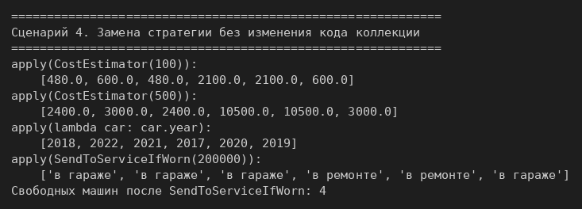
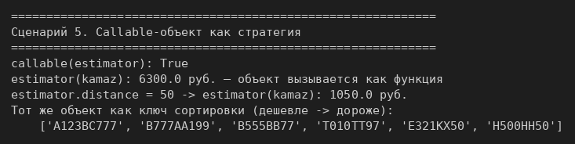

# ЛР-5 — Функции как аргументы. Стратегии и делегаты

## 1. Цель работы
Передавать функции как аргументы, применять `sorted`, `filter`, `map` и `lambda`,
писать фабрики функций (замыкания), реализовать паттерн «Стратегия» через
callable-объекты и цепочки операций над коллекцией.

Используются классы из ЛР-1 и ЛР-3 (`models.py`: `Car`, `Taxi`, `Truck` без изменений)
и коллекция из ЛР-2 (`collection.py`).

## 2. Реализованные функции и стратегии (`strategies.py`)
**Ключи сортировки** (для `key=`): `by_year`, `by_mileage`, `by_brand_then_year`
(возвращает кортеж — сортировка по двум полям).

**Фильтры** (предикаты): `is_available` — по атрибуту (машина в гараже),
`is_truck` — по типу через `isinstance`.

**Фабрика функций**: `make_mileage_filter(max_mileage)` возвращает новую функцию-фильтр,
которая помнит `max_mileage` (замыкание).

**Паттерн «Стратегия»** — классы с методом `__call__`: объект вызывается как функция,
но хранит параметр внутри.
- `CostEstimator(distance)` — стоимость поездки на `distance` км для каждой машины;
- `SendToServiceIfWorn(max_mileage)` — отправляет в ремонт машины с большим пробегом.

**Коллекция** (`collection.py`) получила три метода, которые принимают функцию:
- `sort_by(key_func, reverse)` — новый `Fleet`, отсортированный по ключу;
- `filter_by(predicate)` — новый `Fleet` из подходящих машин (внутри встроенный `filter`);
- `apply(func)` — применяет функцию к каждой машине и возвращает список результатов.

Поскольку `sort_by` и `filter_by` возвращают новый `Fleet`, их можно соединять в цепочку:
```python
fleet.filter_by(is_available).sort_by(by_mileage, reverse=True).apply(CostEstimator(250))
```
Частные выборки из прошлых ЛР (`get_available`, `get_in_service`, `get_by_type`) больше
не нужны: их заменяет `filter_by()` с нужным фильтром. Коллекции не нужно знать правило
отбора — его передают ей как аргумент. `sort()` из ЛР-2 остался: он сортирует на месте,
а `sort_by()` возвращает новый автопарк и поэтому годится для цепочек.

## 3. Соответствие заданию
| Требование | Где сделано |
|---|---|
| ≥ 3 ключа сортировки, `key=` | `by_year`, `by_mileage`, `by_brand_then_year`; `sorted(...)`, `fleet.sort(key=lambda ...)` |
| ≥ 2 фильтра, `filter()` | `is_available`, `is_truck` |
| функция передаётся ссылкой | везде `key=by_year`, а не `by_year(car)` |
| `map()` | номера и возраст машин, сценарий 2 |
| фабрика функций | `make_mileage_filter()` |
| `sort_by()` / `filter_by()` в коллекции | `collection.py` |
| `lambda` vs именованная функция | сценарий 2 |
| стратегия через callable-объект | `CostEstimator`, `SendToServiceIfWorn` |
| `apply(func)` и цепочка операций | `collection.py`, сценарий 3 |
| стратегии в `strategies.py` с docstring | все функции и классы |

## 4. Демонстрация работы
Запуск из папки `src/lab05`: `python demo.py`.

**Сценарий 1.** Три стратегии сортировки через `sorted()`, сортировка на месте по `lambda`
и два фильтра через `filter()` (задание на 3).



**Сценарий 2.** `map()`, фабрика функций, `sort_by` / `filter_by`, сравнение `lambda`
и именованной функции (задание на 4).



**Сценарий 3.** Цепочка `filter → sort → apply` с выводом на каждом шаге (задание на 5).



**Сценарий 4.** Замена стратегии без изменения кода коллекции: один и тот же `apply()`
с разными стратегиями даёт разный результат.



**Сценарий 5.** Callable-объект как стратегия: вызывается как функция, хранит параметр,
работает и как ключ сортировки.



## 5. Вывод
Изучены передача функций как аргументов, `lambda`, `map`, `filter`, `sorted`, функции
высшего порядка и замыкания, паттерн «Стратегия» на callable-объектах и цепочки операций.
