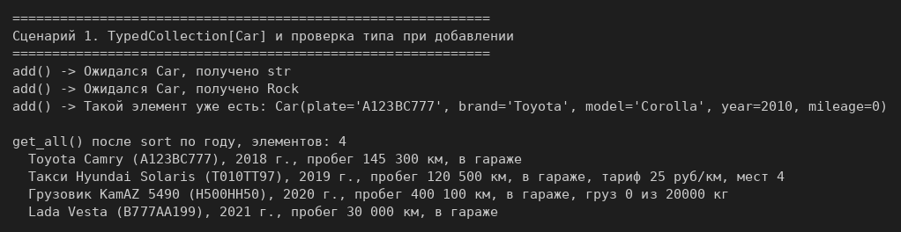
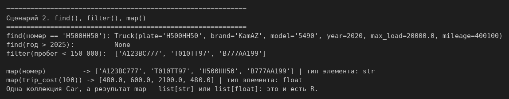
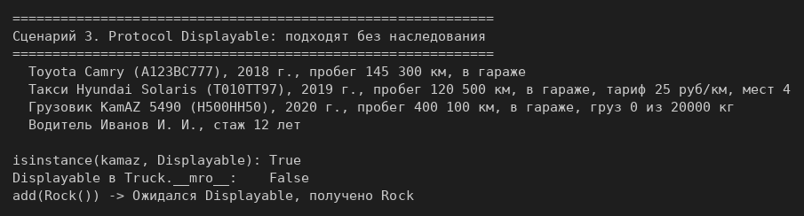
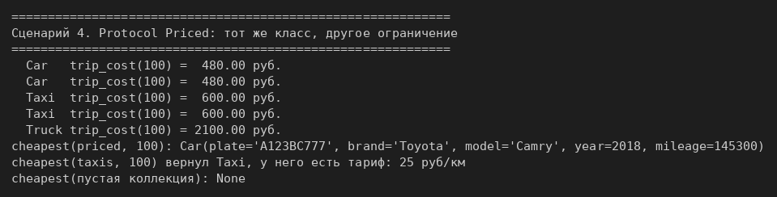

# ЛР-6 — Generics и typing

## 1. Цель работы
Освоить аннотации типов, обобщённые классы (`TypeVar`, `Generic`) и структурную
типизацию через `typing.Protocol`.

## 2. Описание реализованных типов и контейнеров
**Аннотации.** Классы из ЛР-1 и ЛР-3 (`models.py`: `Car`, `Taxi`, `Truck`) и проверки
(`validate.py`) аннотированы полностью: параметры конструкторов, атрибуты в `__init__`,
возвращаемые значения методов. Логика не менялась.

**`TypedCollection[T]`** (`container.py`) — Generic-версия коллекции из ЛР-2; сам `Fleet`
из ЛР-2 не тронут. Перенесены методы `add`, `remove`, `get_all`, `__len__`, `__iter__`,
`__getitem__`, `remove_at`, `sort`. Методы, которые зависели от машин (`find_by_plate`,
`get_available`), заменены общими `find()` и `filter()` с функцией-условием: в обобщённой
коллекции про номер или статус элементов ничего не известно.

Аннотации проверяет mypy до запуска, а во время работы программы они ничего не запрещают.
Поэтому `TypedCollection` получает тип элементов в конструкторе и проверяет его в `add()`
через `isinstance`.

**TypeVar**
| Имя | Ограничение | Зачем |
|---|---|---|
| `T` | нет | тип элементов коллекции |
| `R` | нет | тип результата `map()`: из коллекции `Car` получается `list[str]` или `list[float]` |
| `D` | `bound=Displayable` | только объекты с `display()` |
| `P` | `bound=Priced` | только объекты с `trip_cost()` |

**Протоколы** (`@runtime_checkable`, в `container.py`):
- `Displayable` — метод `display() -> str`;
- `Priced` — метод `trip_cost(distance: int) -> float`.

`Car`, `Taxi` и `Truck` **не наследуются** от протоколов: оба метода у них уже были
с ЛР-3, этого достаточно. Класс `Driver` из демо к машинам отношения не имеет, но у него
есть `display()`, значит он тоже `Displayable`.

Функции с ограниченными TypeVar:
- `show_all(items: TypedCollection[D])` — выводит каждый элемент через `display()`;
- `cheapest(items: TypedCollection[P], distance) -> P | None` — возвращает **тот же тип**,
  что лежит в коллекции: для `TypedCollection[Taxi]` mypy знает, что результат — `Taxi`,
  и разрешает обратиться к `.tariff`.

## 3. Демонстрация работы
Запуск из папки `src/lab06`: `python demo.py`.

**Сценарий 1.** `TypedCollection[Car]`: добавление машин всех трёх типов, проверка типа
и дубликатов при добавлении, сортировка, вывод всех элементов (задание на 3).



**Сценарий 2.** `find()` (найден и `None`), `filter()`, два `map()` с разными типами
результата (задание на 4).



**Сценарий 3.** `TypedCollection[Displayable]` с машинами разных типов и водителем:
подходят без наследования от протокола, `Rock` без `display()` не проходит (задание на 5).



**Сценарий 4.** `TypedCollection[Priced]` — тот же класс с другим ограничением;
`cheapest()` для `Priced`, для `Taxi` и для пустой коллекции.



**Сверх задания: проверка до запуска.** В `typecheck_demo.py` нарочно сделано пять ошибок
типов. Команда `python -m mypy typecheck_demo.py` находит их все, не запуская программу:
```text
typecheck_demo.py:11: error: Argument 1 to "add" of "TypedCollection" has incompatible type "str"; expected "Car"  [arg-type]
typecheck_demo.py:12: error: Argument 1 to "map" of "TypedCollection" has incompatible type "Callable[[Car], int]"; expected "Callable[[Car], str]"  [arg-type]
typecheck_demo.py:12: error: Incompatible return value type (got "int", expected "str")  [return-value]
typecheck_demo.py:14: error: Item "None" of "Car | None" has no attribute "plate"  [union-attr]
typecheck_demo.py:22: error: Argument 1 to "add" of "TypedCollection" has incompatible type "Rock"; expected "Displayable"  [arg-type]
typecheck_demo.py:26: error: Item "Taxi" of "Taxi | None" has no attribute "max_load"  [union-attr]
typecheck_demo.py:26: error: Item "None" of "Taxi | None" has no attribute "max_load"  [union-attr]
Found 7 errors in 1 file (checked 1 source file)
```
Остальные файлы ЛР-6 mypy проходят без ошибок: `python -m mypy models.py validate.py container.py demo.py`.

## 4. Вывод
Изучены аннотации типов, `Generic` и `TypeVar` (в том числе с `bound=`), `Protocol` как
структурный интерфейс без наследования и то, как типизация помогает читать код и находить
ошибки до запуска.
