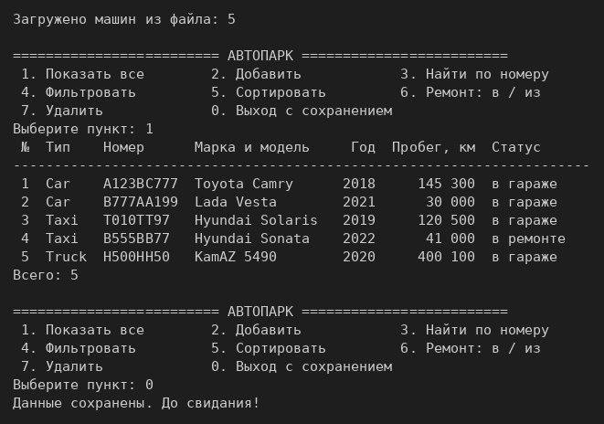
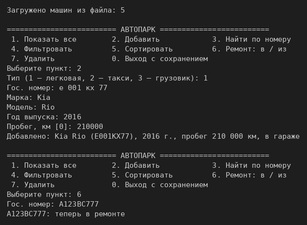
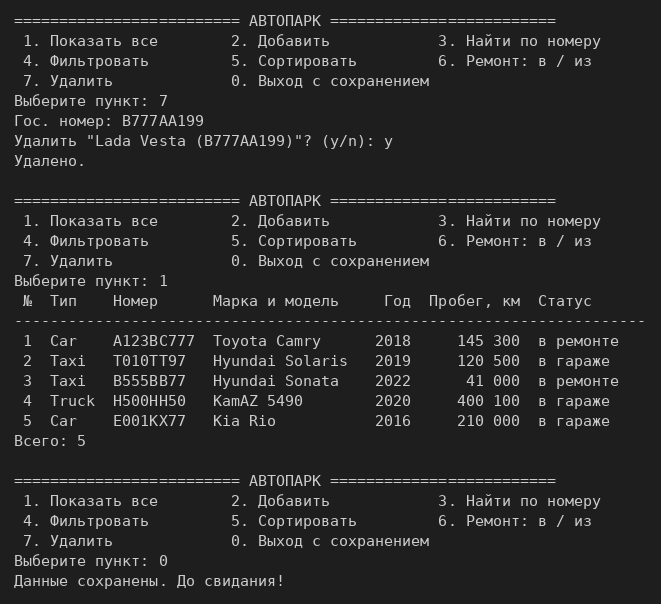
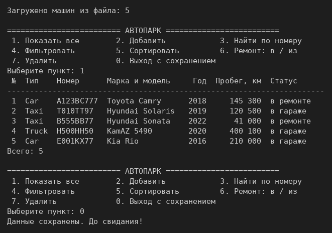
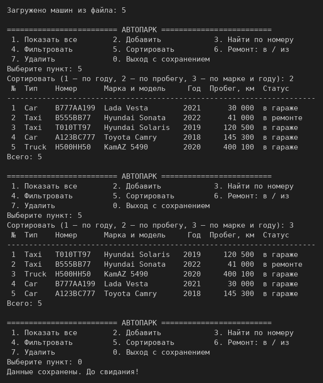
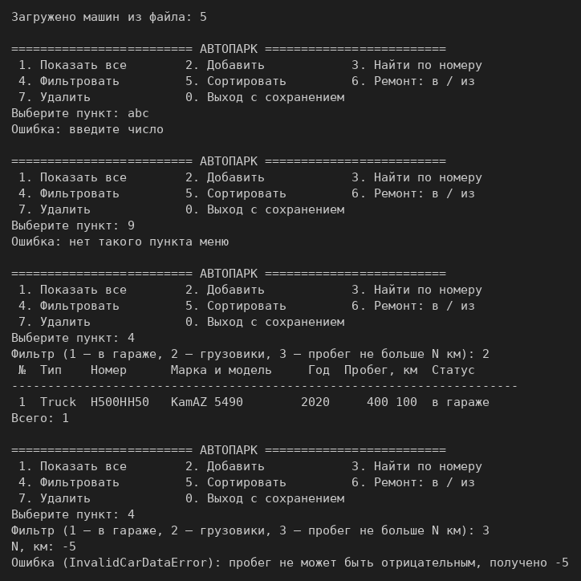
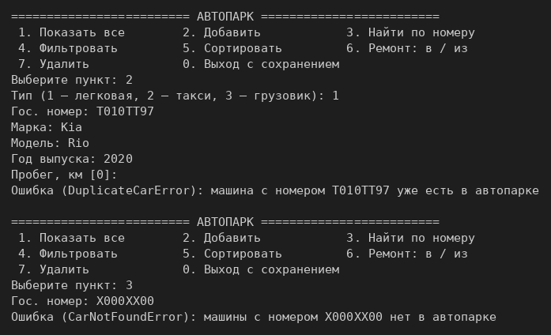
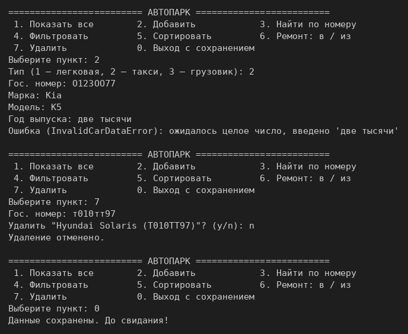

# ЛР-7 — Консольное приложение «Автопарк»

## 1. Цель работы
Объединить ЛР-1–ЛР-6 в работающее CLI-приложение: меню в цикле, три слоя
(интерфейс, логика, модели), собственные исключения, сохранение и загрузка JSON,
поиск, фильтрация и сортировка стратегиями из ЛР-5, аннотации типов из ЛР-6.

## 2. Структура проекта
| Файл | Слой | Назначение |
|---|---|---|
| `main.py` | вход | `python main.py`: собирает `FleetApp` и `FleetCLI`, запускает меню |
| `cli.py` | интерфейс | меню, `input()`, таблицы; бизнес-логики и обращений к коллекции нет |
| `app.py` | логика | `FleetApp` — единственный владелец `Fleet`; все операции, перевод ошибок модели в свои исключения |
| `models.py` | модели | `Car`, `Taxi`, `Truck` из ЛР-6 + `to_dict()` / `from_dict()` для файла |
| `collection.py` | модели | `Fleet` из ЛР-5 с аннотациями |
| `strategies.py` | модели | ключи сортировки и фильтры из ЛР-5, которые использует приложение |
| `validate.py` | модели | проверки данных из ЛР-6 |
| `exceptions.py` | ошибки | `FleetError` и потомки: `CarNotFoundError`, `DuplicateCarError`, `InvalidCarDataError`, `StorageError` |
| `storage.py` | данные | `save(fleet, path)` и `load(path)` — JSON |
| `fleet.json` | данные | пять машин для примера; перезаписывается при выходе |

CLI не трогает коллекцию: он вызывает только методы `FleetApp`. `FleetApp` превращает
`TypeError` и `ValueError` модели в исключения предметной области, а CLI ловит один
базовый `FleetError` и печатает имя исключения и сообщение.

## 3. Описание CLI
```
========================= АВТОПАРК =========================
 1. Показать все        2. Добавить            3. Найти по номеру
 4. Фильтровать         5. Сортировать         6. Ремонт: в / из
 7. Удалить             0. Выход с сохранением
```
- **Добавить** — легковая, такси или грузовик; номер можно вводить в любом регистре и с пробелами.
- **Фильтровать** — машины в гараже, только грузовики или пробег не больше N км
  (`is_available`, `is_truck`, фабрика `make_mileage_filter` из ЛР-5).
- **Сортировать** — по году, по пробегу или по марке и году (`by_year`, `by_mileage`,
  `by_brand_then_year` из ЛР-5).
- **Ремонт** — редактирование: отправить машину в ремонт или вернуть из ремонта.
- **Удалить** — только после подтверждения `y/n`.

**Ошибки ввода.** Пункт меню читается через `int(input())`: строка вместо числа даёт
сообщение «введите число», несуществующий пункт — «нет такого пункта». Числа в формах
читают `_ask_int` и `_ask_float`: при ошибке они бросают `InvalidCarDataError`.
Любой `FleetError` печатается, и меню показывается снова. `Ctrl+C` — тоже выход с сохранением.

**Сохранение и загрузка.** При запуске `FleetApp.load()` читает `fleet.json` (нет файла —
пустой автопарк, файл повреждён — сообщение и выход без перезаписи). При выходе `save()`
записывает список `car.to_dict()`. При загрузке класс выбирается по ключу `"type"` через
словарь `CAR_TYPES`, без `if`. Статус и груз восстанавливаются обычными методами
(`send_to_service()`, `load()`), поэтому невозможное состояние из файла не пройдёт проверки.

**Типизация и документация.** Все функции и методы в `app.py`, `cli.py`, `storage.py`
аннотированы и имеют docstring; `python -m mypy *.py` — без ошибок.

## 4. Демонстрация работы
Запуск из папки `src/lab07`: `python main.py`. В исходном `fleet.json` пять машин.

**Сценарий 1.** Запуск → автозагрузка из `fleet.json` → вывод таблицей → выход с сохранением.



**Сценарий 2.** Добавление Kia Rio (номер введён строчными с пробелами), отправка Toyota в ремонт…



…удаление Lada Vesta с подтверждением `y/n`, вывод, выход с сохранением.



Повторный запуск: Kia на месте, Lada удалена, Toyota в ремонте — данные сохранились в файл.



**Сценарий 3.** Сортировка с выбором стратегии: по пробегу, затем по марке и году.



**Сценарий 4.** Ошибки ввода и перехват исключений: строка вместо пункта меню,
несуществующий пункт, фильтр «грузовики», фильтр по пробегу с отрицательным N
(`InvalidCarDataError`)…



…добавление машины с уже существующим номером (`DuplicateCarError`), поиск
несуществующего номера (`CarNotFoundError`)…



…год словами вместо числа (`InvalidCarDataError`), отказ от удаления (`n`), выход.



## 5. Вывод
Изучены разбиение программы на модули и слои, интерактивный CLI в цикле, собственные
исключения и их перехват, сохранение данных в JSON и загрузка с проверкой, аннотации
типов и docstring в прикладном коде.
