# ЛР-7 — Консольное приложение «Автопарк»

## 1. Цель работы
Объединить ЛР1–ЛР6 в работающее CLI-приложение с меню, тремя слоями, собственными
исключениями, сохранением/загрузкой JSON, поиском, фильтрацией и сортировкой.

## 2. Структура проекта
| Файл | Слой | Назначение |
|---|---|---|
| `main.py` | вход | `python main.py`: собирает `FleetApp` + `FleetCLI` |
| `cli.py` | интерфейс | меню, `input()`, форматированные таблицы; бизнес-логики нет |
| `app.py` | логика | класс `FleetApp`: единственный владелец `Fleet`, все операции |
| `models.py` | модели | `Car`, `Taxi`, `Truck` (ЛР-6) + `from_dict()` |
| `collection.py`, `strategies.py`, `interfaces.py`, `validate.py` | модели | из ЛР-5/ЛР-6 без изменений |
| `exceptions.py` | ошибки | `FleetError` и потомки: `CarNotFoundError`, `DuplicateCarError`, `InvalidCarDataError`, `CarStateError`, `UnknownStrategyError`, `StorageError` |
| `storage.py` | данные | `save(fleet, path)`, `load(path)` — JSON |
| `fleet.json` | данные | создаётся автоматически при первом выходе |

CLI не обращается к коллекции напрямую: только через `FleetApp`. `FleetApp`
переводит `TypeError`/`ValueError` модели в исключения предметной области,
а CLI ловит один `FleetError` и печатает сообщение.

## 3. Описание CLI
```
1. Показать все машины          5. Сортировать
2. Добавить машину              6. Операции с машиной (заправка, поездка, ремонт)
3. Найти машину по номеру       7. Удалить машину
4. Фильтровать                  8. Статистика автопарка
0. Выход (с сохранением)
```
**Ошибки ввода**: `ask_int`/`ask_float` перехватывают `ValueError` и возвращают `None`;
неверный пункт меню — сообщение и повтор; ошибки предметной области — `except FleetError`.

**Сохранение/загрузка**: при запуске `FleetApp.load()` читает `fleet.json` (нет файла —
пустой парк), при выходе `save()` записывает список `car.to_dict()`. Класс восстанавливается
по ключу `"type"` через реестр `CAR_TYPES`, статус — через методы перехода (`_restore_status`),
поэтому невозможное состояние из файла не воспроизведётся.

**Сортировка** — стратегии из ЛР-5 (`SORT_STRATEGIES`), **фильтры** — предикаты и фабрики
из ЛР-5, **типизация** — все методы `app.py`/`cli.py` аннотированы (mypy: 0 ошибок),
**подтверждение** — удаление требует `y/n`.

## 4. Демонстрация работы (`python main.py`)

Исходные данные — `fleet.json` с четырьмя машинами (грузовик, два такси, легковая).

**Сценарий 1.** Запуск → автозагрузка данных из `fleet.json` → вывод коллекции таблицей → выход с сохранением.

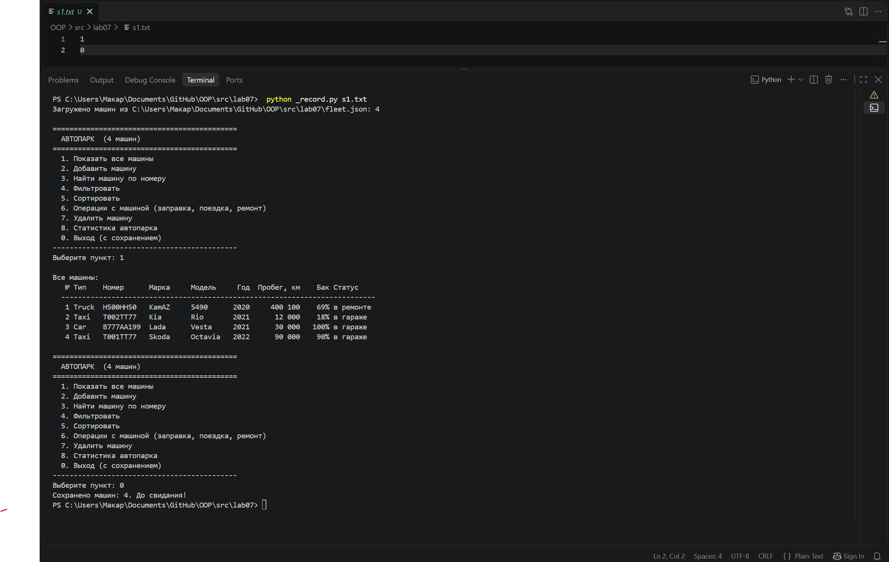

**Сценарий 2.** Добавление машины (Toyota Camry, пустой ввод = значение по умолчанию) → удаление
Lada Vesta с подтверждением `y/n` → вывод → выход с сохранением.

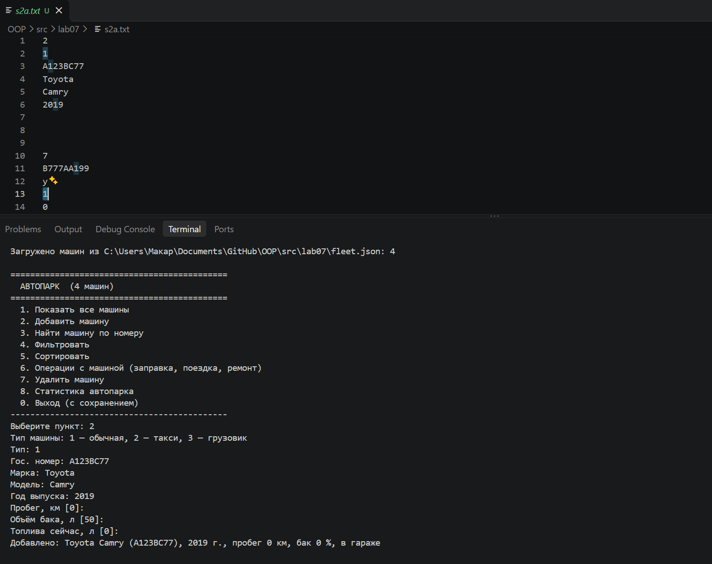
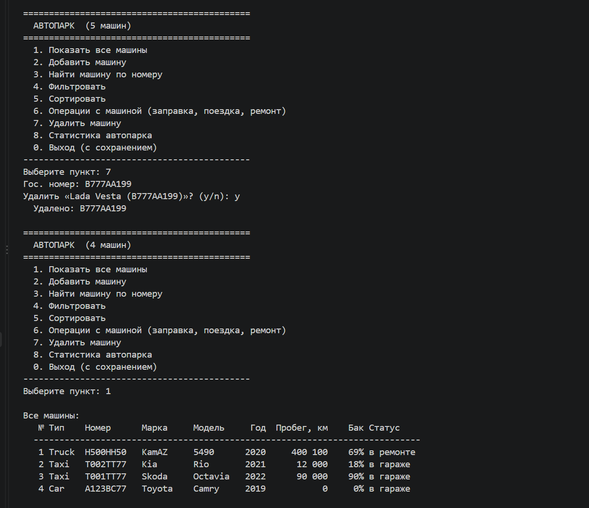
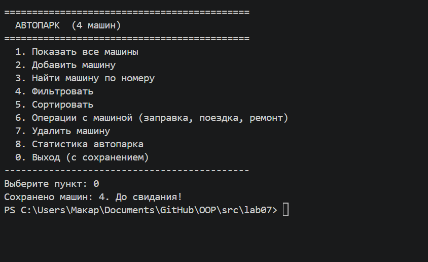

Повторный запуск: загружены те же 4 машины — Toyota на месте, Lada удалена, то есть данные сохранились в файл.

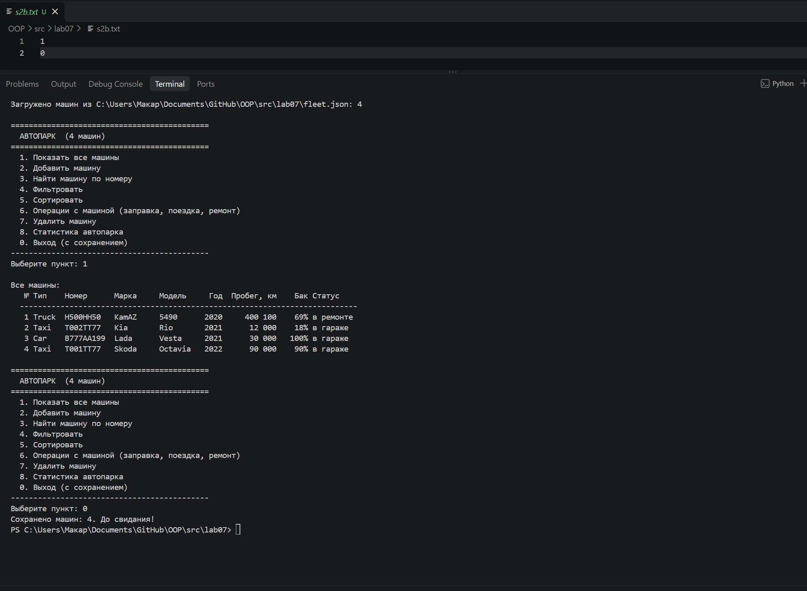

**Сценарий 3.** Сортировка с выбором стратегии через меню: по пробегу по убыванию, затем по гос. номеру по возрастанию.

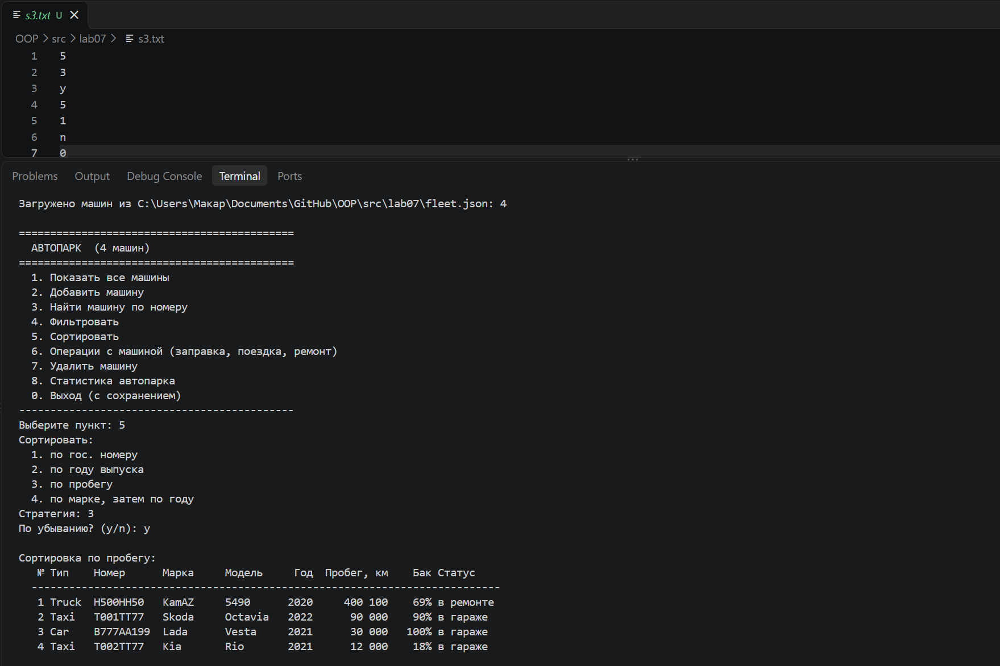
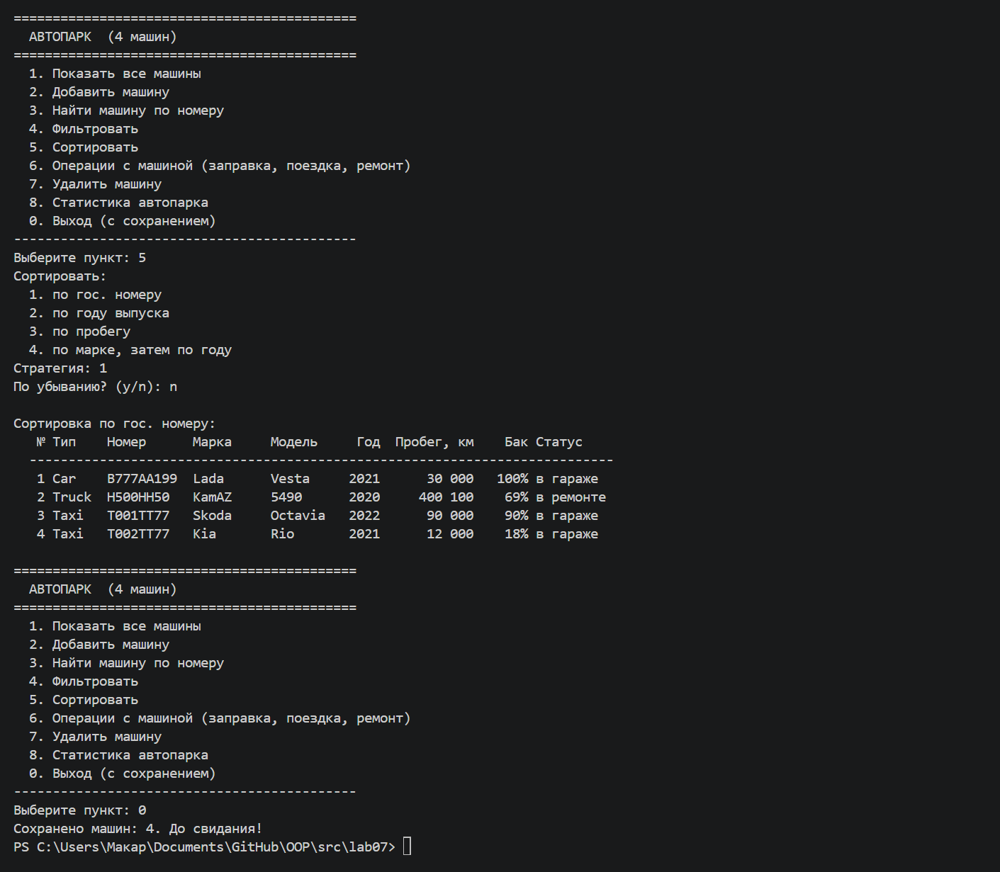

**Сценарий 4.** Некорректный ввод и перехват исключений:
- строка вместо номера пункта и несуществующий пункт меню — сообщение, программа продолжает работу;
- фильтр «только такси»;
- фильтр по году с недопустимым значением 1800 → `InvalidCarDataError`;
- добавление машины с уже существующим номером → `DuplicateCarError`;
- поиск несуществующего номера → `CarNotFoundError`.

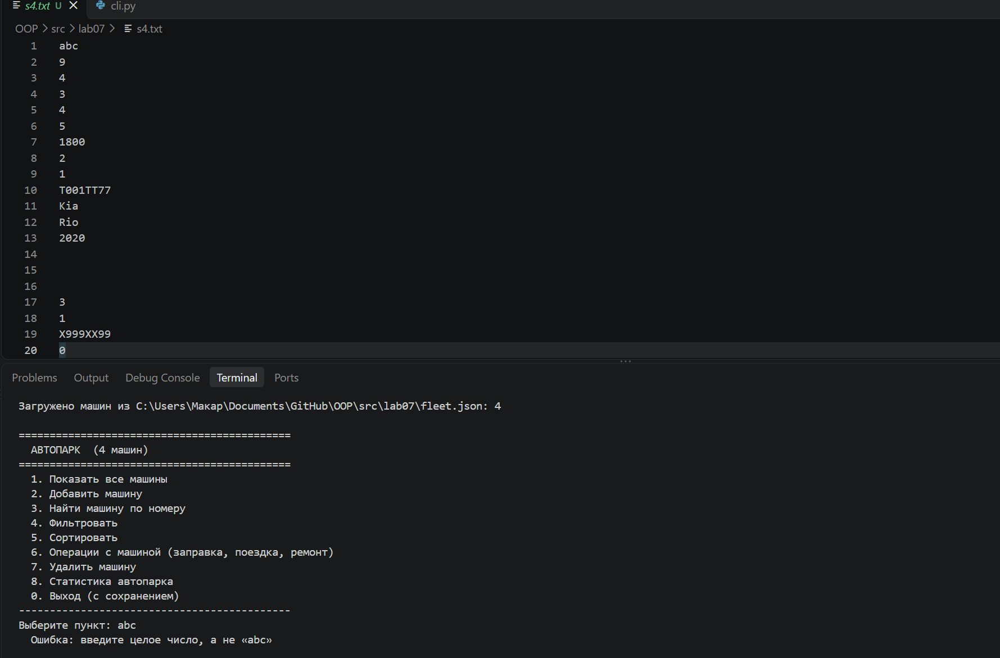
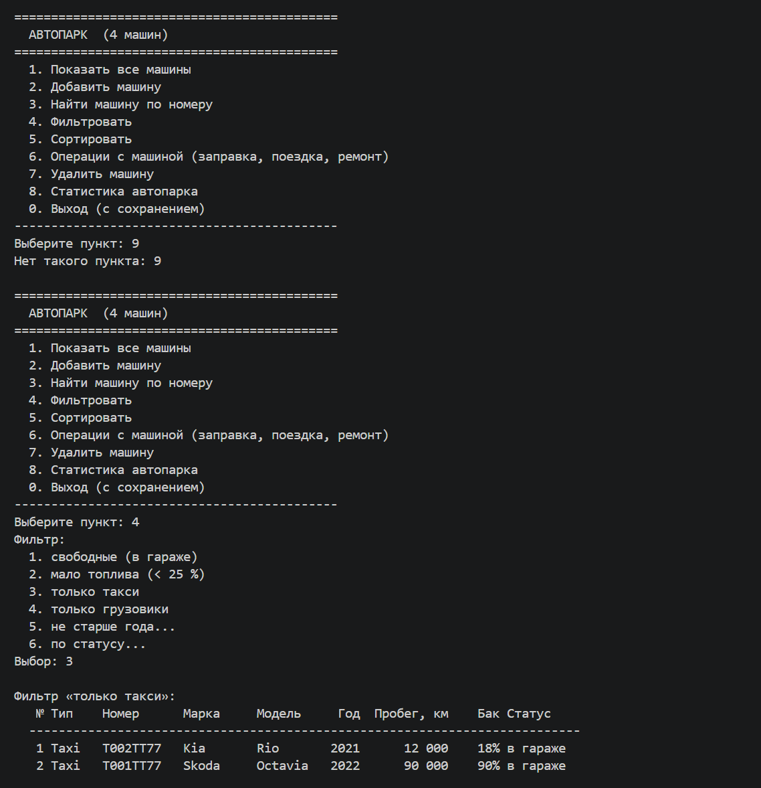
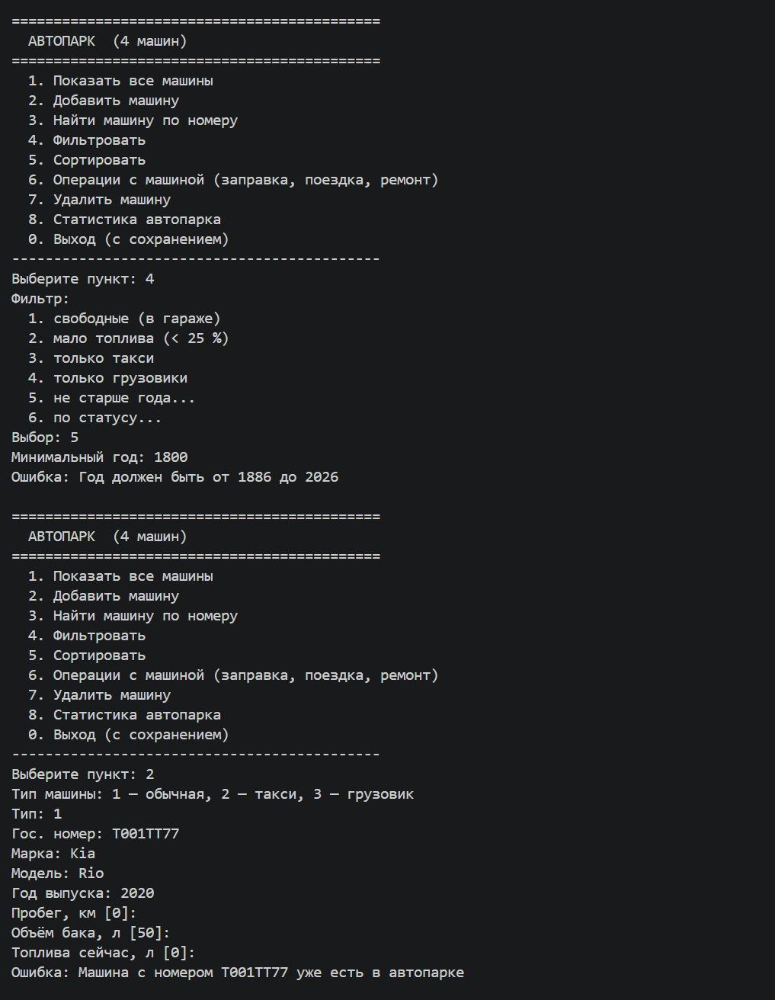
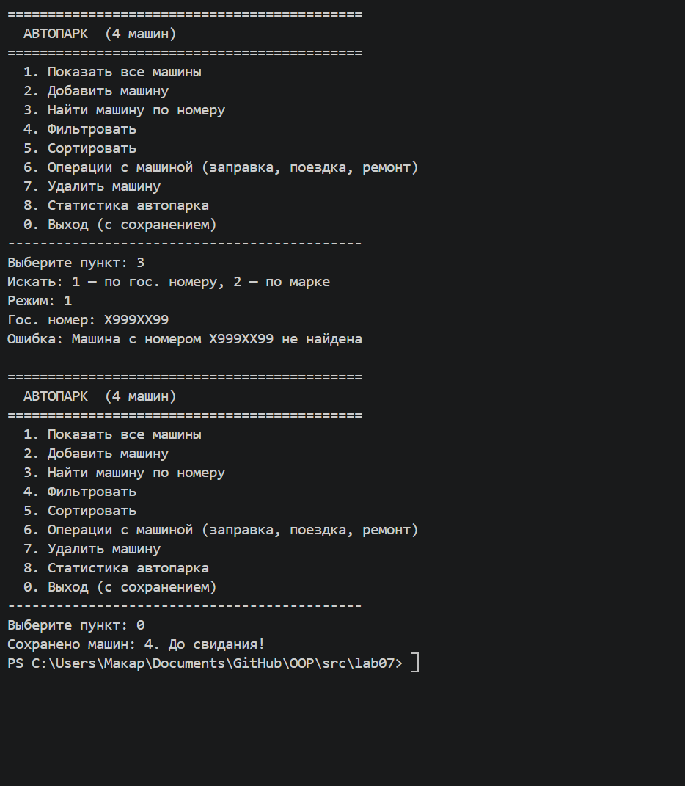

## 5. Вывод
Изучено разбиение на модули и слои, интерактивный CLI, собственные исключения,
работа с JSON-файлами и типизация в прикладном коде.
